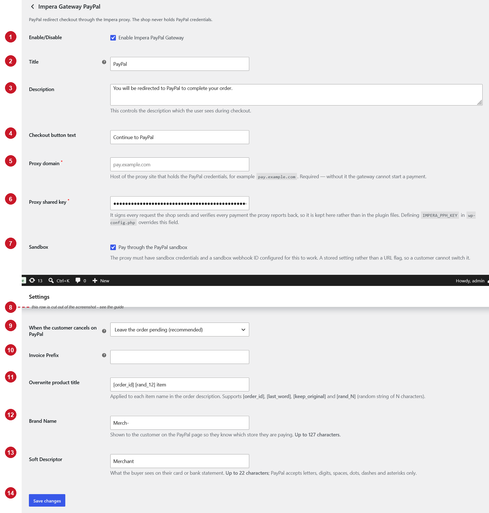

# Impera Gateway PayPal — Setup Guide

This guide walks through installing the **Impera Gateway PayPal** plugin and explains every field on
its settings screen. The numbers in the screenshot below match the numbered sections in
[Settings reference](#4-settings-reference).

---

## 1. Before you start

Have these ready before you open the settings screen:

| Requirement | Notes |
|---|---|
| **WooCommerce, active** | The plugin does nothing at all if WooCommerce is not active. |
| **PHP 8.1 or newer** | The plugin uses PHP 8.1 language features and will not load on older versions. |
| **A supported store currency** | See [Appendix A](#appendix-a--supported-currencies). If your store currency is not on the list, the payment method hides itself at checkout and no setting can bring it back. |
| **Your connection details** | The **host name** and the **shared key** you were issued. You cannot complete the setup without both. |

---

## 2. Install and activate

1. Copy the plugin folder to `wp-content/plugins/impera-gateway-paypal-headless/`.
2. Go to **Plugins** in WordPress and activate **Impera Gateway PayPal (Headless)**.

---

## 3. Open the settings screen

**WooCommerce → Settings → Payments → Impera Gateway PayPal** (click *Manage* next to the method).

---

## 4. Settings reference



> Field **8** exists on the real settings screen but was cut out of this screenshot. It sits between
> **7 Sandbox** and **9 When the customer cancels on PayPal**.

Fields marked with a red asterisk on screen are required.

### 1. Enable/Disable

Ticking **Enable Impera PayPal Gateway** turns the payment method on.

Ticking it is necessary but not sufficient — the method only appears at checkout when **all** of
these are true: it is enabled, **5** is filled in, **6** is filled in, and the store currency is
supported. If any of them is missing the method silently disappears from checkout rather than
failing during payment.

*Default: disabled.*

### 2. Title

The name of the payment method as the customer sees it in the checkout list, next to the radio
button. Keep it short and recognisable.

*Default: `PayPal`.*

### 3. Description

The short text shown under the title once the customer selects this method. Use it to set the
expectation that the customer leaves the shop to pay, for example
*"You will be redirected to PayPal to complete your order."*

Leave it empty if you do not want any text.

*Default: `You will be redirected to PayPal to complete your order.`*

### 4. Checkout button text

The label of the checkout's place-order button while this payment method is selected. Because the
customer is taken away from the shop to pay, a label such as **Continue to PayPal** is clearer than
the WooCommerce default *"Place order"*.

*Default: `Continue to PayPal`.*

### 5. Proxy domain — required

The host name the gateway connects to, exactly as it was issued to you.

- Enter the **host only**: `pay.example.com`
- Do **not** include `https://`, a path, a port or a trailing slash
- Do not add `www.` unless the value you were given has it

The field can arrive pre-filled with a leftover value from the plugin defaults — always replace it
with the host you were actually given.

If this field is empty, the payment method does not appear at checkout.

### 6. Proxy shared key — required

The secret key used to authenticate communication between your shop and the payment service. Paste
the key exactly as issued.

- Copy and paste it — do not retype it
- No leading or trailing spaces, no line breaks
- It is a password field, so the value is masked after saving; to change it, clear the field and
  paste the new key
- The key must be identical on both sides. If the two copies differ, payments cannot be verified.

**Overriding the key from `wp-config.php`.** If you prefer to keep the secret out of the database,
add this line to `wp-config.php`:

```php
define( 'IMPERA_PPH_KEY', 'your-shared-key-here' );
```

When that constant is defined and not empty it **wins over this field**, and editing the field on
screen changes nothing. Remember that if you are ever debugging a key mismatch.

If neither the field nor the constant holds a key, the payment method does not appear at checkout.

### 7. Sandbox

Ticking **Pay through the PayPal sandbox** routes payments through PayPal's test environment, so you
can place orders with test accounts and no real money moves.

- The service you connect to must be configured for sandbox as well — enabling this on the shop
  alone is not enough.
- It is a stored setting, not a URL parameter, so a customer cannot switch a live shop into test
  mode by editing the address bar.
- **Untick it before going live.** A sandbox-paid order is marked in the order notes with
  `THIS IS A TEST ORDER!!!!`.

*Default: disabled.*

### 8. Shipping address on PayPal

> Not visible in the screenshot above — on the real screen it sits directly below **7 Sandbox**.

Controls whether PayPal shows a shipping address during payment:

| Option | Behaviour |
|---|---|
| **Do not show** *(recommended)* | PayPal shows no address at all. Right for a shop that already collected the address on its own checkout. |
| **Show the order address** | PayPal displays the address from the order; the buyer cannot change it. |
| **Let the buyer choose on PayPal** | The buyer may pick a different address on PayPal. |

Be careful with the last option: a different address can change shipping costs and therefore the
order total. A payment whose amount no longer matches the order is **refused** — the order is not
marked paid, an order note records the mismatch, and it is left for manual reconciliation.

*Default: Do not show.*

### 9. When the customer cancels on PayPal

What happens to the order when the customer presses *Cancel* on the PayPal page instead of paying.

| Option | Behaviour |
|---|---|
| **Leave the order pending** *(recommended)* | The order stays pending and the customer can pay it later from **My Account → Orders**. Stock stays reserved. |
| **Cancel the order** | The order is closed immediately and the stock is released back to the catalogue. |

Choose *Cancel the order* only if you would rather free stock quickly than let hesitant customers
come back and finish paying.

*Default: Leave the order pending.*

### 10. Invoice Prefix

A prefix added to the order number in reporting, useful when several stores report into the same
place — for example `SHOP1-`.

This value is **not** sent to PayPal as an invoice id. PayPal requires invoice ids to be unique
across the whole account, and would reject a retried payment that reused one.

The field can arrive pre-filled with a leftover default; clear it or replace it with your own
prefix.

*Optional.*

### 11. Overwrite product title

Rewrites each item name in the description that goes out with the payment. Leave it empty to send
the real product names.

Supported placeholders:

| Placeholder | Replaced with |
|---|---|
| `[order_id]` | The WooCommerce order id |
| `[last_word]` | The last word of the original product name |
| `[keep_original]` | The original product name, unchanged |
| `[rand_N]` | A random string of *N* characters, e.g. `[rand_7]` |

Example — `Order [order_id] item [rand_7]` produces something like `Order 1042 item k3n8qwz`.

Anything that is not a placeholder is used literally, so `[keep_original]` on its own is equivalent
to leaving the field empty.

*Optional.*

### 12. Brand Name

The store name shown to the customer on the PayPal page, so they recognise who they are paying.
If it is empty, PayPal falls back to the account's own business name.

**Up to 127 characters.**

*Optional, but recommended — it reduces abandoned payments and chargebacks.*

### 13. Soft Descriptor

What the buyer sees on their card or bank statement next to the charge.

- **Up to 22 characters**
- PayPal accepts letters, digits, spaces, dots, dashes and asterisks only — other characters can
  cause the payment to be rejected
- Make it recognisable as your store; an unfamiliar descriptor is one of the most common causes of
  a disputed charge

*Optional.*

### 14. Save changes

Nothing on this screen takes effect until you press **Save changes**.

---

## 5. Minimum working configuration

1. **1** — tick *Enable Impera PayPal Gateway*
2. **5** — enter your host name
3. **6** — paste your shared key
4. **12** — enter your store name
5. **13** — enter a recognisable statement descriptor (max 22 characters)
6. **7** — tick *Sandbox* while testing, untick it before going live
7. **14** — **Save changes**

Everything else can stay at its default.

---

## 6. Test the setup

1. Tick **7 Sandbox**, save, and confirm the method now appears on the checkout page.
2. Place a test order and choose the method. You should be redirected away to pay.
3. Complete the payment with a test account. You should land back on the order-received page and
   the order should become **Processing**.
4. Open the order in **WooCommerce → Orders** and check the **Order notes** panel — it records the
   whole payment trail, including the `THIS IS A TEST ORDER!!!!` note for sandbox orders.
5. Repeat once and, on the PayPal page, press **Cancel**. Confirm the order behaves the way you
   chose in **9**.
6. From the paid test order, issue a refund in the WooCommerce order screen and confirm it goes
   through.
7. Untick **7 Sandbox**, save, and place one small real order before announcing the method.

---

## 7. Troubleshooting

**The payment method does not appear at checkout.**
Check, in order: **1** is ticked; **5** is filled in; **6** is filled in (or `IMPERA_PPH_KEY` is
defined in `wp-config.php`); the store currency is in [Appendix A](#appendix-a--supported-currencies).
The method hides itself when any of these is missing — this is deliberate, so customers never reach
a payment that cannot complete.

**"We could not verify your payment, please contact us before trying again."**
The shop and the service are not using the same shared key. Re-paste the key into **6** — watch for
a trailing space or a line break from copy-paste. If `IMPERA_PPH_KEY` is defined in `wp-config.php`,
that value is the one in use, not the field.

**"We cannot process your payment right now, please try another payment method."**
The shop could not start the payment. Usually a wrong or unreachable value in **5**, or a missing
key. Check the plugin log at **WooCommerce → Status → Logs** for the exact reason.

**The customer paid but the order is still pending.**
Open the order and read the **Order notes** — every step of the payment is recorded there, including
amounts and any mismatch. An order left pending after a real payment always has a note explaining
why.

**An order says the amount does not match.**
The total changed after the payment started — most often caused by *Let the buyer choose on PayPal*
in **8**. The order is deliberately not marked paid; reconcile it by hand and consider switching
**8** to *Do not show*.

**Refunds fail.**
Refunds are only possible for orders that were actually paid through this method and still carry
their payment data. Orders paid another way, or imported orders, cannot be refunded from here.

---

## Appendix A — Supported currencies

The payment method is only offered when the store currency is one of these:

`AUD` `BRL` `CAD` `CHF` `CZK` `DKK` `EUR` `GBP` `HKD` `HUF` `ILS` `JPY` `MXN` `MYR` `NOK` `NZD`
`PHP` `PLN` `SEK` `SGD` `THB` `TWD` `USD`

---

## Appendix B — Settings at a glance

| # | Field | Required | Default |
|---|---|---|---|
| 1 | Enable/Disable | — | Disabled |
| 2 | Title | — | `PayPal` |
| 3 | Description | — | `You will be redirected to PayPal to complete your order.` |
| 4 | Checkout button text | — | `Continue to PayPal` |
| 5 | Proxy domain | **Yes** | — |
| 6 | Proxy shared key | **Yes** | — |
| 7 | Sandbox | — | Disabled |
| 8 | Shipping address on PayPal | — | Do not show |
| 9 | When the customer cancels on PayPal | — | Leave the order pending |
| 10 | Invoice Prefix | — | — |
| 11 | Overwrite product title | — | — |
| 12 | Brand Name | — | — |
| 13 | Soft Descriptor | — | — |
